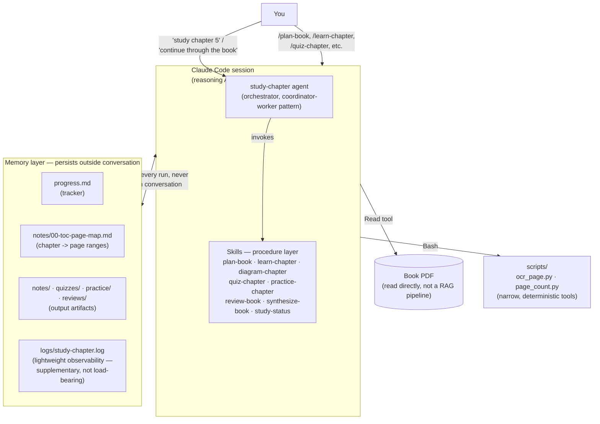
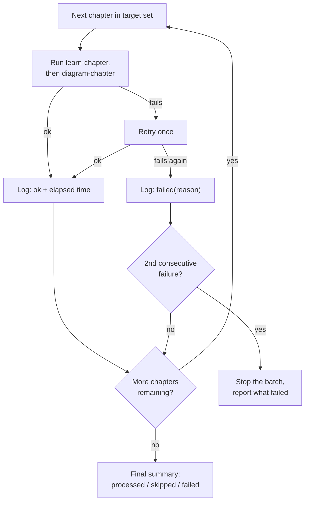

# StudyLaunchpad

A small toolkit of [Claude Code](https://claude.com/claude-code) skills and
an agent that turn any book PDF into a structured, interactive study
workflow: chapter notes, Mermaid diagrams, Socratic quizzes, hands-on coding
exercises with tests, spaced cross-chapter review, and an end-of-book
synthesis — all generated by reading the PDF directly, no manual
page-wrangling required.

## What's in here

```
.claude/
  skills/
    plan-book/         one-time setup: builds the chapter→page map and progress tracker
    learn-chapter/     reads one chapter from the PDF, writes structured notes
    diagram-chapter/   turns a chapter's notes into Mermaid diagrams
    quiz-chapter/      interactive, turn-by-turn Socratic quiz from the notes
    practice-chapter/  small hands-on exercises with tests, then reviews your attempt
    review-book/       spaced cross-chapter review, targeted at what you got wrong before
    synthesize-book/   book-level through-line, concept map, and a capstone spec
    study-status/      where you are and the one thing to do next
  agents/
    study-chapter.md   orchestrates learn-chapter + diagram-chapter, single
                       chapter or resumable batch across a range/whole book
  settings.json        pre-allows the toolkit's own scripts, so setup doesn't
                       stop for permission prompts mid-run
scripts/
  page_count.py        PDF page count, used by plan-book to bound the last chapter
  ocr_page.py          OCR fallback for a single page, when Claude's direct
                       PDF view renders a page too illegibly to read
init.sh                bootstraps a new book-study project from this toolkit
```

## Requirements

- [Claude Code](https://claude.com/claude-code) CLI.
- Python packages: `pymupdf`, `pytesseract`, `pillow`.
- `tesseract` (system package) — only for the OCR fallback path. Most
  chapter reading goes through Claude's native PDF rendering and never
  touches it.

Install however fits your system (`apt`, `brew`, `nix`/Home Manager, etc).
None of this is Claude-Code-specific — it's just what the two scripts in
`scripts/` need at runtime.

## Using it on a new book

```sh
./init.sh ~/study/my-book path/to/your-book.pdf
cd ~/study/my-book && claude
```

`init.sh` copies `.claude/` and `scripts/` into the target directory and puts
the PDF beside them. It never overwrites anything already there, so you can
re-run it on a live project to pick up toolkit updates you've added since.

Then, in Claude Code:

1. **`/plan-book`** — once per book. Reads the PDF's table of contents, works
   out the offset between printed and PDF page numbers (books almost never
   number the first few pages the same way the `Read` tool's `pages`
   parameter counts them), and writes:
   - `notes/00-toc-page-map.md` — every chapter's PDF page range
   - `progress.md` — one row per chapter, tracking completion dates
2. **Per chapter**, in whatever order and at whatever pace you like:
   - `/learn-chapter` (or `/learn-chapter 5`) — read a chapter, write notes
   - `/diagram-chapter` — turn a chapter's notes into Mermaid diagrams
   - `/quiz-chapter` — get quizzed, one question at a time
   - `/practice-chapter` — get exercises with tests; run it again later and
     it reviews your attempt instead of regenerating over your work
   - the **`study-chapter`** agent — "study chapter 5" for notes+diagrams in
     one pass, or "continue through the book" / "chapters 5 through 10" for a
     resumable batch that skips whatever's already done in `progress.md` and
     can be stopped and picked back up any time
3. **Across chapters**, once a few are done:
   - `/review-book` — spaced review spanning several chapters, weighted
     toward concepts your past quiz transcripts show you actually missed
   - `/synthesize-book` — at the end: the book's through-line, a concept
     dependency map, and one capstone project spec
   - `/study-status` — any time, to see where you are and what's next

Each skill updates `progress.md` itself as it finishes, so it's always an
accurate picture of what's done — nothing here guesses from the
conversation; it re-reads the file fresh each time.

## Architecture

What this repo actually is, in the vocabulary the toolkit itself teaches
(this is a book-study toolkit, so it's fitting that its own design maps
onto the architecture patterns from the books it's used to study — agent
loops, orchestrators, memory layers, tools).



The honest part of this diagram is the top box: unlike the production agent
patterns this toolkit's skills teach you to build, there's no separate
component validating a skill's output before it's committed — the same
Claude Code session that interprets a skill's instructions is also the one
writing the file. That's a deliberate, acknowledged trade-off for a small
prose-driven toolkit (see "Verifying a change" in `CLAUDE.md`), not an
oversight — but it's worth naming rather than implying a control boundary
that isn't actually there.

`study-chapter`'s batch mode is the one place with a real multi-step loop,
so it's the one place that needed an explicit failure policy, not just a
stopping condition:



One bad chapter (an illegible page, a transient write issue) shouldn't
block the rest of a 14-chapter batch — but two in a row is treated as a
structural signal (a bad page-map offset, a broken environment) worth
stopping for, rather than burning through the remaining chapters repeating
the same failure.

## Design notes

- **Everything is book-agnostic.** No book title, page count, or path is
  hardcoded anywhere — `plan-book` discovers all of it from the PDF.
- **Each phase is a separate skill, by design.** Reading a chapter,
  diagramming it, quizzing it, and practicing it are separate,
  user-triggered steps rather than one pipeline — so you control the pace
  instead of being pushed through all of them every time.
- **Practice exercises come with tests, and no solutions.** Each exercise
  ships `test_*.py` files of plain asserts that define correctness, runnable
  with bare `python3`. The tests are the answer key; a worked solution next
  to the stub would defeat the exercise. Everything is stdlib-only so there's
  no environment to debug before practicing.
- **Review is targeted, not random.** `quiz-chapter` saves transcripts with
  your answers as given, wrong ones included. `review-book` mines those for
  the concepts you actually fumbled and re-asks them from a different angle,
  so a gap that never closed shows up as one.
- **Practice assumes a technical book.** The notes, diagram, quiz, review,
  and synthesis skills work for any subject, but `practice-chapter` generates
  code (Python by default, or the book's own language). On a non-technical
  book, skip it — the rest of the workflow stands on its own.
- **Notes/diagrams/quizzes/practice/reviews are never checked into this
  repo.** They belong to whatever book-study project you build with this
  toolkit, not to the toolkit itself — see `.gitignore`.

See `CLAUDE.md` for the contract between skills, if you're extending them.

## License

MIT — see `LICENSE`.
